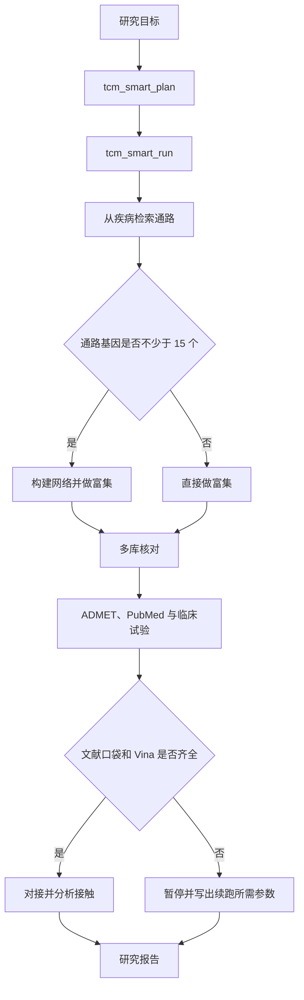

# OpenTCM Discovery

OpenTCM Discovery 是一个开源的中药小分子发现工具。它把疾病通路检索、成分与靶点的多库核对、网络分析、理化性质估算和分子对接放在同一个 MCP 服务里，研究者可以在智能体或命令行中按同一套证据规则完成计算筛选。

这个项目适合网络药理学和天然产物的前期研究。它帮助你缩小后续实验的范围，并保留每一步的数据来源。它不能证明某个成分已经有效，也不能代替医师给出用药建议。对接结果、文献共现和临床试验匹配都只是下一步阅读或实验的线索。

[](LICENSE)
[](requirements.txt)
[](docs/TOOLS.md)

一次典型的分析从疾病或成分出发，先检索公开数据库，再根据基因数量决定是否构建蛋白互作网络，然后核对多个数据库是否同时收录该靶点或成分。只有在文献已经写明结合口袋时，才会继续做 AutoDock Vina 对接。每条在线结果都带有 `source` 和 `queried_at`。科学边界的完整说明见 [docs/SCIENTIFIC_SCOPE.md](docs/SCIENTIFIC_SCOPE.md)，下一阶段要补的数据库和测试见 [docs/ROADMAP.md](docs/ROADMAP.md)。

## 目录

- [这个项目为谁而做](#这个项目为谁而做)
- [现在可以完成的工作](#现在可以完成的工作)
- [快速开始](#快速开始)
- [接入智能体](#接入智能体)
- [两条计算路径](#两条计算路径)
- [七个模块](#七个模块)
- [证据上我们坚持的几件事](#证据上我们坚持的几件事)
- [数据、文献与上游数据库](#数据文献与上游数据库)
- [仓库结构](#仓库结构)
- [质量与后续计划](#质量与后续计划)
- [引用与许可](#引用与许可)

## 这个项目为谁而做

如果你正在做中药或天然产物的计算筛选，希望先知道一个疾病对应哪些通路、一味药里有哪些已收录成分、一个成分在哪些数据库里能对上，再用文献中的口袋看结合姿势，这个仓库就是为这条工作准备的。

它同时提供两种用法。第一种是 MCP 服务，供 Cursor 等智能体按自然语言目标调用 54 个工具。第二种是本地打分流程，读取你自己准备的机制表、临床药表和分子库。两种用法不互相调用，避免把在线检索和本地加权分混成一条证据。

## 现在可以完成的工作

| 你想回答的问题 | 从这里开始 |
|---|---|
| 这个疾病对应哪些通路和基因？ | `tcm_kegg_disease_pathways`，或直接运行 `tcm_smart_run` |
| 这个成分或基因是否被多个数据库同时收录？ | `tcm_cross_database_screen` |
| 网络里哪些基因更靠中心，两条富集是否一致？ | `tcm_network_analysis`，然后 `tcm_multi_enrichment` |
| 黄连和黄芩的成分集合重叠多少？ | `tcm_formula_analysis` |
| 文献已经给出口袋，想看一个对接姿势 | `dock_vina_docking`，然后 `dock_analyze_contacts` |
| 几个成分里先做哪一个实验？ | `tcm_multi_path_run`。排名是启发式排序，不是验证过的打分函数 |
| 手里已有机制表和分子库，想做可重复的加权评分 | `workflow_engine/run_server.py` |

全部工具的分工见 [docs/TOOLS.md](docs/TOOLS.md)。

## 快速开始

需要 Python 3.10 或更高版本。

```bash
python -m pip install -r requirements.txt
```

在 Windows 上建议先执行 `$env:PYTHONUTF8="1"`，避免中文输出乱码。

下面的命令会启动服务器，打印已注册工具的数量，并探测一次数据库状态：

```bash
python examples/basic_usage.py
```

正常情况下会看到 `tools registered: 54`。这一步需要访问公网。没有网络时服务器仍能启动，检索工具会返回上游错误，而不是本地编造的结果。

分子对接还需要 AutoDock Vina 1.2.5 和 Meeko。可执行文件不随 Git 提交，放置方法写在 [bin/README.md](bin/README.md)。没有 Vina 时，检索、网络、文献和临床试验工具不受影响。

## 接入智能体

推荐使用 stdio。把下面的配置贴到 MCP 客户端里，并把路径换成你本机的克隆目录。同一份模板在 [mcp_server/deployment_config.json](mcp_server/deployment_config.json)。

```json
{
  "mcpServers": {
    "open-tcm-discovery": {
      "command": "python",
      "args": ["D:/path/to/open-tcm-discovery/mcp_server/unified_mcp.py", "--stdio"],
      "env": { "PYTHONUTF8": "1" }
    }
  }
}
```

如果要常驻 HTTP 服务，进程只绑定本机，默认端口是 **8002**：

```bash
python mcp_server/unified_mcp.py --port 8002
```

客户端地址是 `http://127.0.0.1:8002/mcp`。请不要把 `open_tcm_discovery_mcp.py` 当作完整服务来用。单独运行那个文件时，只能得到检索相关的工具，默认端口也是 8000。

带参数的工具把参数放在 `params` 里：

```python
await session.call_tool("tcm_smart_run", {
    "params": {
        "goal": "研究溃疡性结肠炎的候选成分 berberine，给出 ADMET、文献共现和临床试验情况",
        "max_runtime": 400
    }
})
```

环境变量、端口冲突和常见报错见 [docs/DEPLOYMENT.md](docs/DEPLOYMENT.md)。

## 两条计算路径



`tcm_smart_plan` 只生成计划。`tcm_smart_run` 执行上图中的在线步骤。如果把深度设为 `full`，四步药材脚本会被写成一条延后命令，不会在同一次请求里抓取那 30 到 60 分钟的数据。

另一条路径是本地有向无环图。它读取你自己的 Excel 和 CTD 文件，在 8765 端口打开看板，不调用上面的 MCP 工具。步骤、阈值和断点续跑见 [docs/WORKFLOWS.md](docs/WORKFLOWS.md)，模块如何分层见 [docs/ARCHITECTURE.md](docs/ARCHITECTURE.md)。

## 七个模块

| 模块 | 它负责什么 | 说明 |
|---|---|---|
| M1 | 从疾病到通路、药材、口服生物利用度达标的成分，再做错误发现率校正 | [m1_disease_screening.md](modules/m1_disease_screening.md) |
| M2 | 多个数据库的共识、靶点开发等级和标识互转 | [m2_target_evidence.md](modules/m2_target_evidence.md) |
| M3 | 网络中心节点，以及两个富集引擎是否一致 | [m3_network_enrichment.md](modules/m3_network_enrichment.md) |
| M4 | 分子库构建、质量检查和五层去重 | [m4_molecular_library.md](modules/m4_molecular_library.md) |
| M5 | Vina 对接、接触分析和几何蛋白质相互作用 | [m5_docking_modeling.md](modules/m5_docking_modeling.md) |
| M6 | 论文图和证据标注 | [m6_figures_documentation.md](modules/m6_figures_documentation.md) |
| M7 | 记录运行中发现的失效接口和复现问题 | [m7_self_iteration.md](modules/m7_self_iteration.md) |

按 TCMSP 的历史口径，口服生物利用度不低于 30、类药性不低于 0.18，才把成分放进「活性成分」这道筛选门。RDKit 计算的 Lipinski 规则和 QED 是另一套理化描述符，写报告时要分开，不能混成同一个结论。TCMSP 网站在 2026 年 9 月的探测中不可用，因此这道门只适用于你已经持有的 TCMSP 字段，不能临时改用其他库的类药性数值代替。

## 证据上我们坚持的几件事

实验记录、晶体或核磁模板、计算预测分成三层来写。对接输出称为 proposed docking model。只在计算中出现的残基要标上星号，接触用虚线表示。

口袋残基必须来自文献。没有口袋时，执行引擎会暂停并列出缺什么，不会为了跑完流程去猜一个盒子，也不会做全蛋白盲对接。2025 年对网络药理学论文的核查表明，大量对接没有报告盒子中心和大小，其中不少实质上是盲对接，结果难以复现（Frontiers in Pharmacology, 2025, 1566772）。

已知相互作用和相似搜索、对接打分得出的预测靶点也不能写成同一类证据。HERB 用文献做 Fisher 精确检验来关联靶点，BATMAN-TCM 2.0 则同时收录人工核对过的相互作用和大规模预测；这两类数字不能加在一起叫做「共识」（Frontiers in Pharmacology, 2024, 1303693；Nucleic Acids Research, 2024, gkad926）。当前版本的多库共识表示「这些库都收录了该实体」，不表示结合已经被实验证实。把已知靶点和预测靶点拆开计数，写在 [下一阶段路线](docs/ROADMAP.md) 里。

## 数据、文献与上游数据库

仓库自带的 `data/herb_mol_index.json` 记录 698 味药材与 25,975 个成分的对应关系，只用于药对的集合运算。它来自 SymMap 2.0 的药材与成分关联（Wu 等，Nucleic Acids Research, 2019, 47(D1): D1110–D1117），不是预先写好的疾病答案。字段和重建方法见 [data/README.md](data/README.md)。

运行时会访问的公开来源包括 SymMap、PubChem、ChEMBL、KEGG、STRING、Open Targets、UniProt、NCBI、ClinicalTrials.gov、HERB、TCMBank 和 NPASS。各库的进入方式、我们是否直接调用，以及已知不能调用的接口，列在 [docs/DATA_SOURCES.md](docs/DATA_SOURCES.md)。请遵守各数据库自己的使用条款。本仓库不附带这些库的全量镜像。

## 仓库结构

```
SKILL.md                 给智能体读的使用约定
mcp_server/              54 个工具的服务器
tcm_core/                超几何检验、口袋残基和索引路径等可单测的函数
scripts/                 可单独运行的检索、分子库、对接和出图脚本
workflow_engine/         11 步本地打分流程和看板
modules/                 七个模块的说明
references/              接口、失效记录、作图和证据分级
data/                    SymMap 药材与成分索引
docs/                    给使用者和维护者的说明
tests/                   不访问网络的单元测试
examples/                最小客户端和调用样例
```

## 质量与后续计划

```bash
python scripts/check_repo.py
python -m unittest discover -s tests -v
```

前一条命令不访问网络。它检查 Python 语法、54 个工具的名字是否都写进工具总表，并阻止已经废弃的端口、工具数和本机路径写回文档。后一条命令核对超几何尾概率、Benjamini–Hochberg 校正、成分名提取和口袋残基解析。扑克牌算例要求：52 张牌、13 张红心、抽 5 张，至少 3 张红心的概率约为 0.0928。

在线行为的历史记录在 [CHANGELOG.md](CHANGELOG.md) 和 `mcp_server/evaluation.xml`。上游接口会变化，正式分析前请运行 `tcm_check_database_status`。

## 引用与许可

```bibtex
@software{open_tcm_discovery,
  title  = {OpenTCM Discovery},
  year   = {2026},
  url    = {https://github.com/S0mbraD/OpenTCM_Discovery},
  note   = {MCP service for TCM small-molecule discovery, 54 tools}
}
```

机器可读条目在 [CITATION.cff](CITATION.cff)。如果结果使用了 Vina 或 SymMap，请同时引用对应的软件和数据库论文。

代码使用 [MIT 许可证](LICENSE)。Vina 使用 Apache-2.0，说明见 [NOTICE](NOTICE)。

本仓库用于科研和教学，不构成医疗建议。计算预测需要实验验证。

[文档](docs/README.md) · [贡献](CONTRIBUTING.md) · [安全](SECURITY.md) · [行为准则](CODE_OF_CONDUCT.md) · [变更](CHANGELOG.md)
