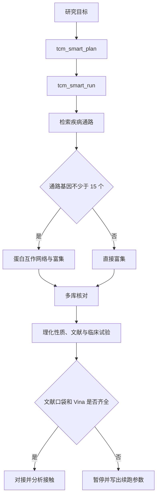

# OpenTCM Discovery

OpenTCM Discovery 检索中药小分子，供网络药理学和天然产物的前期研究使用。它查询疾病通路和成分，核对公开数据库是否同时收录，并只在文献写明结合口袋时做分子对接。

一次调用拿到的是当次查询或本地计算的结果，不是写好的疾病答案。在线成功时看 `source` 和 `queried_at`。失败时看 `error`，或正文是否以 `Error:` 开头。列表是空的，表示这次没有取到行，工具不会另编一条补上。对接要等文献写明口袋残基，并且本机找得到 Vina，输出按提议的对接模型来写。

[](LICENSE)
[](requirements.txt)
[](docs/TOOLS.md)
[](https://github.com/S0mbraD/OpenTCM_Discovery/actions/workflows/ci.yml)

Pathway search, cross-database checks, and literature-guided docking for TCM small molecules.

## 目录

- [适合谁](#适合谁)
- [安装](#安装)
- [启动](#启动)
- [两种用法](#两种用法)
- [七个模块](#七个模块)
- [仓库目录](#仓库目录)
- [结果怎么读](#结果怎么读)
- [数据](#数据)
- [自检](#自检)
- [引用与许可证](#引用与许可证)

## 适合谁

做网络药理学、天然产物筛选，或准备对接实验的人，可以用它先把公开记录整理清楚。下表只帮你选入口。点进去之后仍要读返回字段，工具名本身不是结论。

| 你要回答的问题 | 从这里开始 |
|---|---|
| 这个疾病对应哪些通路和基因？ | `tcm_kegg_disease_pathways`，或 `tcm_smart_run` |
| 这个成分或基因是否被多个数据库同时收录？ | `tcm_cross_database_screen` |
| 网络里哪些基因更靠中心？两个富集结果是否一致？ | `tcm_network_analysis`，然后 `tcm_multi_enrichment` |
| 两味药的成分集合重叠多少？ | `tcm_formula_analysis` |
| 文献已经给出口袋，想看一个对接姿势 | `dock_vina_docking`，然后 `dock_analyze_contacts` |
| 几个成分里先做哪一个实验？ | `tcm_multi_path_run` |
| 手里已有机制表和分子库，想做可重复的加权评分 | `workflow_engine/run_server.py` |
| 表、基因名、疾病名、剂量或 SMILES 还没整理好？ | `tcm_clean_table`、`tcm_normalize_ids`、`tcm_normalize_genes`、`tcm_normalize_disease`、`tcm_convert_dose`、`tcm_normalize_structure` |
| 已有 TCMSP 成分行，要对上自己的名称或 InChIKey？ | `tcm_align_tcmsp` |

工具分工见 [docs/TOOLS.md](docs/TOOLS.md)。

## 安装

需要 Python 3.10 或更高版本。

```bash
python -m pip install -r requirements.txt
```

在 Windows 上先执行下面这行，避免中文输出乱码。

```powershell
$env:PYTHONUTF8 = "1"
```

对接需要 AutoDock Vina 1.2.5 和 Meeko。可执行文件不放进 Git。放法见 [bin/README.md](bin/README.md)。没装 Vina 时，检索、网络、文献和临床试验工具仍可使用。

本地有向无环图另需 pandas 和 PyYAML：

```bash
python -m pip install -r requirements-workflow.txt
```

依赖装好之后，可以先跑两条不访问网络的检查。`python scripts/check_repo.py` 核对语法，以及文档里用反引号写出的工具名是否和代码里注册的 64 个一致。`python -m unittest discover -s tests -q` 核对统计函数、口袋解析和本地整理。这两条通过，只说明仓库本身是齐的。上游网站通不通，要另跑 `tcm_check_database_status`。

## 启动

支持 MCP 的客户端都可以接这套服务。配置里的 `<仓库路径>` 换成你的克隆目录。Cursor 的配置文件只是例子之一。同一份模板在 [mcp_server/deployment_config.json](mcp_server/deployment_config.json)。

stdio 由客户端在需要时拉起本地进程：

```json
{
  "mcpServers": {
    "open-tcm-discovery": {
      "command": "python",
      "args": ["<仓库路径>/mcp_server/unified_mcp.py", "--stdio"],
      "env": { "PYTHONUTF8": "1" }
    }
  }
}
```

需要常驻服务时用 Streamable HTTP。进程只监听本机，默认端口是 **8002**：

```bash
python mcp_server/unified_mcp.py --port 8002
```

客户端地址是 `http://127.0.0.1:8002/mcp`。64 个工具都在 `unified_mcp.py`。

只运行 `open_tcm_discovery_mcp.py` 时，进程里只有检索一族，HTTP 默认端口是 8000，不是上面这个 8002。对接族若单独运行 `structure_docking_mcp.py`，默认端口是 8001。本地看板默认是 8765。这几个进程各用各的端口。stdio 不占端口，客户端在需要时拉起子进程，用完就退出，这是推荐接法。

确认工具已经注册：

```bash
python examples/basic_usage.py
```

正常时第一行是 `tools registered: 64`。接着会打印 `tcm_check_database_status` 的一段文字。这次调用的 `refresh` 是 false，所以看到的是工具里保存的探测表。表上的 `snapshot_date` 是那张表写入的日期，不是此刻每个网站的现场状态。把 `refresh` 设为 true 才会再探一小部分端点，需要公网，大约几十秒。公网不通时，工具数仍应是 64。状态一段里会是失败或不可达，不要把它读成「这个库没有该成分」。

带参数的工具把参数放在 `params` 里：

```python
await session.call_tool("tcm_smart_run", {
    "params": {
        "goal": "研究溃疡性结肠炎的候选成分 berberine，给出理化性质、文献共现和临床试验情况",
        "max_runtime": 400
    }
})
```

`tcm_smart_run` 返回的是会话正文，不是一篇结论。先看 `session_id` 和 `status`。`done` 表示这次在线链走完。`paused` 表示缺文献口袋、缺 Vina、结构文件没拉下来，或到了 `max_runtime`。暂停时会列出 `needs`。用同一个 `session_id` 补上 `docking_inputs` 再调用，已完成的步不会重跑。`deferred scripts` 里的命令这次没有执行。`depth=full` 时，四步药材脚本就记在这里。决策日志是 D1 到 D6 的分支记录。通路基因少于 15 个时，第 2 步的工具名会写成 skipped，状态仍是 ok，表示按 D1 直接去做富集，不是这次请求失败了。后面的分析拓扑写着节点、边、图例、检索通路、下一步建议和数据源状态，用来看检索走到哪一步，不是疗效结论。

参数要放在 `params` 里。若把 `goal` 直接放在外层，校验失败，返回的是参数错误，不是空的检索结果。

环境变量、端口占用和常见报错见 [docs/DEPLOYMENT.md](docs/DEPLOYMENT.md)。

## 两种用法

### MCP 服务

用中文写出疾病和成分。`tcm_smart_plan` 只生成计划。`tcm_smart_run` 执行在线步骤。通路基因不少于 15 个时建蛋白互作网络，否则直接做富集。文献口袋和 Vina 都齐了，才进入对接。

`depth=full` 时，四步药材脚本记成一条延后命令，不在同一次请求里抓取。那一步通常要 30 到 60 分钟，命令见 [docs/WORKFLOWS.md](docs/WORKFLOWS.md)。



### 本地有向无环图

这条路径读你自己的 Excel 和 CTD 文件，做加权评分，并在本机打开看板。

```bash
copy workflow_engine\config.example.yaml workflow_engine\config.yaml
python workflow_engine/run_server.py
```

看板默认地址是 `http://127.0.0.1:8765/`。`config.yaml` 含本机数据路径，不要提交。步骤、阈值和断点续跑见 [docs/WORKFLOWS.md](docs/WORKFLOWS.md)。

看板打不开时，先看 `config.yaml` 里的 `server.port`，默认 8765，以及本机数据文件路径是否存在。MCP 没启动不会让看板自动起来，看板没开也不会让 `tcm_smart_run` 失败。两边的数字不要写进同一句结论。

MCP 检索和本地加权分是两套结果，引用时分开写。前者写数据库来源和查询时间。后者写输入表和权重。

## 七个模块

| 模块 | 负责的事 | 说明 |
|---|---|---|
| M1 | 从疾病到通路、药材和成分，再做错误发现率校正 | [m1_disease_screening.md](modules/m1_disease_screening.md) |
| M2 | 多个数据库是否同时收录，以及标识互转 | [m2_target_evidence.md](modules/m2_target_evidence.md) |
| M3 | 网络中心节点，以及两个富集结果是否一致 | [m3_network_enrichment.md](modules/m3_network_enrichment.md) |
| M4 | 分子库构建、质量检查和去重 | [m4_molecular_library.md](modules/m4_molecular_library.md) |
| M5 | Vina 对接、接触分析和几何蛋白质相互作用 | [m5_docking_modeling.md](modules/m5_docking_modeling.md) |
| M6 | 论文图和证据标注 | [m6_figures_documentation.md](modules/m6_figures_documentation.md) |
| M7 | 记录运行中发现的失效接口和复现问题 | [m7_self_iteration.md](modules/m7_self_iteration.md) |

分层和决策点见 [docs/ARCHITECTURE.md](docs/ARCHITECTURE.md)。后面要补的数据库和测试见 [docs/ROADMAP.md](docs/ROADMAP.md)。

## 仓库目录

```
SKILL.md                 给智能体读的使用约定
mcp_server/              64 个工具的服务器
tcm_core/                超几何检验、口袋残基和索引路径等可单测的函数
scripts/                 可单独运行的检索、分子库、对接和出图脚本
workflow_engine/         11 步本地评分流程和看板
modules/                 七个模块的说明
references/              接口说明、作图和证据分级
data/                    SymMap 药材与成分索引
docs/                    使用和部署说明
tests/                   不访问网络的单元测试
examples/                最小客户端和调用样例
```

文档索引见 [docs/README.md](docs/README.md)。

## 结果怎么读

计算结果用来提出可检验的假设。

- 每条在线结果带 `source` 和 `queried_at`。上游报错就返回报错，不另编一条记录。
- 实验记录、结构模板和计算预测分开写。
- 对接输出写成 proposed docking model。只在计算里出现的残基标 `*`，接触画虚线。
- 口袋残基来自文献。没有口袋就不对接，也不做全蛋白盲对接。
- 多个库同时收录，只表示这些库都有该实体。已知相互作用和预测靶点分开计数。
- 文献共现是命中篇数。临床试验匹配是登记信息。二者用来找下一步要读的论文和要做的实验。
- 口服生物利用度不低于 30、类药性不低于 0.18，才按 TCMSP 口径写入「活性成分」。RDKit 的 Lipinski 和 QED 另写。
- `tcm_align_tcmsp` 只对齐调用方已经给出的成分名和 InChIKey。名称相同不是结构相同，也不是靶点或疗效。
- 多候选排名是启发式排序，不是验证过的打分函数。

跑不通时按这个顺序判断。先看参数是不是放进了 `params`，疾病名或成分名是不是空的。再看 `error`，或正文是否以 `Error:` 开头。在线失败时仍可能带有 `source` 和 `queried_at`，同时成分或命中列表为空。这种空表示这次没取到，不要手写成一条完整记录。TCMSP 若 `herbs` 有多行而 `ingredients` 为空，是药材名对上了多行，把 `latin_name` 设成其中一行的 `herb_en_name` 再查。缓存命中时，`queried_at` 仍是当初查询的时间。

方剂分析返回里，高重叠那一档的标签字面是「功效相近」。它按成分集合的重叠系数划分，不是药效。剂量换算必须点名口径：`metric`、`market_1959`、`han_tang`、`song_yuan_2025`、`ming_qing_2025`、`song_jin_yuan_2024`、`ming_qing_2024`。这些「两」的克数不一样，不能并成一个通用单位。预测靶点不是已记录证据。`tcm_cross_database_screen` 的共识分只表示几个库同时查到了该实体。

完整约定见 [docs/SCIENTIFIC_SCOPE.md](docs/SCIENTIFIC_SCOPE.md)。图注和残基标注见 [references/evidence_grading.md](references/evidence_grading.md)。

本仓库用于科研和教学，不能当作医疗建议。

## 数据

`data/herb_mol_index.json` 记录 698 味药材和 25,975 个成分的对应关系，用来算药对的成分集合。数据来自 SymMap 2.0（Wu 等，Nucleic Acids Research, 2019, 47(D1): D1110–D1117）。这里没有写好的疾病答案。字段和重建方法见 [data/README.md](data/README.md)。

运行时会访问 SymMap、PubChem、ChEMBL、KEGG、STRING、Open Targets、UniProt、NCBI、ClinicalTrials.gov、HERB、TCMBank、NPASS 和 TCMSP 旧站。各库怎么接入、是否直接调用，见 [docs/DATA_SOURCES.md](docs/DATA_SOURCES.md)。请遵守各数据库自己的使用条款。仓库不带这些库的全量镜像。

`tcm_tcmsp_search` 只请求 `https://old.tcmsp-e.com/`。成分行看 `molecule_name`、`MOL_ID`、`ob`、`dl`。`ob_dl_filter` 默认关闭。打开后只去掉本页不满足 OB≥30 且 DL≥0.18 的行，去掉的行数在 `ob_dl_dropped`。这道门不用于 HERB 的类药性，也不用于 RDKit 的 Lipinski 或 QED。这一页没有靶点列。`references/database_availability_2026-09.md` 是 2026 年 9 月的端点快照，不能拿来判断现在该请求哪个 TCMSP 地址。当前接法以 [docs/DATA_SOURCES.md](docs/DATA_SOURCES.md) 里 2026-10-13 的探测为准。

正式分析前先运行 `tcm_check_database_status`。`refresh` 为 false 时读保存的探测表，看 `snapshot_date`。要看现在通不通，再设为 true。

## 自检

```bash
python scripts/check_repo.py
python -m unittest discover -s tests -v
```

这两条命令不访问网络。第一条检查 Python 语法，并核对 64 个工具名是否与文档一致。第二条核对超几何尾概率、Benjamini–Hochberg 校正、成分名提取和口袋残基解析。

第一条失败时，先看它打印的工具名差异。常见情况是 `docs/TOOLS.md` 少了某个用反引号包住的工具名，或文档里的工具总数和代码不一致。不要为了让检查通过去改统计函数或数据源地址。第二条失败时，看断言期望的是本地夹具还是真实网站。默认测试不访问网络。在线接口变了，记进变更记录，并用 `tcm_check_database_status` 再探一次。一次超时不能写成该库已经停用。

上游接口会变。变更记录见 [CHANGELOG.md](CHANGELOG.md)。

## 引用与许可证

```bibtex
@software{open_tcm_discovery,
  title  = {OpenTCM Discovery},
  year   = {2026},
  url    = {https://github.com/S0mbraD/OpenTCM_Discovery},
  note   = {MCP service for TCM small-molecule discovery, 64 tools}
}
```

机器可读条目在 [CITATION.cff](CITATION.cff)。结果里用了 Vina 或 SymMap 的，请一并引用它们的论文。

代码使用 [MIT 许可证](LICENSE)。Vina 使用 Apache-2.0，说明见 [NOTICE](NOTICE)。

[文档](docs/README.md) · [贡献](CONTRIBUTING.md) · [安全](SECURITY.md) · [行为准则](CODE_OF_CONDUCT.md) · [变更](CHANGELOG.md)
