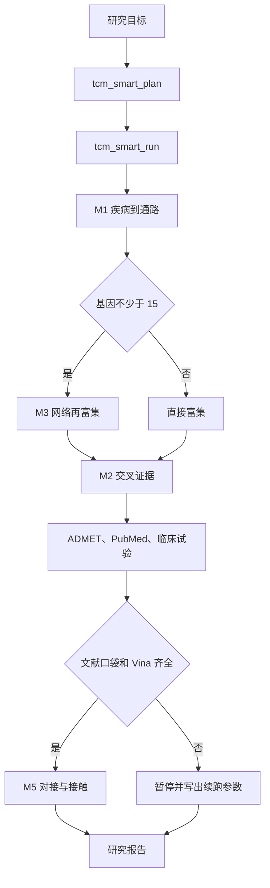

# open-tcm-discovery

中药小分子的检索、网络药理学、对接与证据分级。一个 MCP 服务器，54 个工具，给研究 Agent 和命令行共用。

[](LICENSE)
[](requirements.txt)
[](docs/TOOLS.md)

在线结论来自当次请求，带 `source` 和 `queried_at`。对接输出是 proposed docking model。文献共现和临床试验匹配是索引，不是疗效。完整边界见 [docs/SCIENTIFIC_SCOPE.md](docs/SCIENTIFIC_SCOPE.md)。

## 目录

- [能做什么](#能做什么)
- [快速开始](#快速开始)
- [接入 Agent](#接入-agent)
- [两条运行时](#两条运行时)
- [模块](#模块)
- [仓库结构](#仓库结构)
- [数据与上游](#数据与上游)
- [质量](#质量)
- [引用](#引用)
- [许可](#许可)

## 能做什么

| 问题 | 入口 |
|---|---|
| 这个病有哪些通路和基因？ | `tcm_kegg_disease_pathways`，或 `tcm_smart_run` |
| 这个成分或基因有哪些库同时收录？ | `tcm_cross_database_screen` |
| 哪些基因是网络里的 hub，富集是否两边一致？ | `tcm_network_analysis` → `tcm_multi_enrichment` |
| 黄连和黄芩的成分集合差多少？ | `tcm_formula_analysis` |
| 文献口袋已知，想看一个对接姿势 | `dock_vina_docking` → `dock_analyze_contacts` |
| 多个成分哪一个先做实验？ | `tcm_multi_path_run`（启发式排名） |
| 手头有机制表和分子库，要打分 | `workflow_engine/run_server.py` |

54 个工具的分工见 [docs/TOOLS.md](docs/TOOLS.md)。

## 快速开始

Python 3.10 及以上。

```bash
python -m pip install -r requirements.txt
```

Windows 建议先设置 `$env:PYTHONUTF8="1"`。

列出工具并做一次数据库探测：

```bash
python examples/basic_usage.py
```

期望输出 `tools registered: 54`。这一步需要公网。没有公网时，服务器仍能启动，检索工具会返回上游错误。

对接还需要 AutoDock Vina 1.2.5 和 Meeko。二进制不随 git 提交，放置方法见 [bin/README.md](bin/README.md)。没有 Vina 时，检索和网络工具不受影响。

## 接入 Agent

推荐 stdio。把下面的配置贴进 MCP 客户端，并把路径换成你的克隆目录。模板也在 [mcp_server/deployment_config.json](mcp_server/deployment_config.json)。

```json
{
  "mcpServers": {
    "open-tcm-discovery": {
      "command": "python",
      "args": ["D:/path/to/open-tcm-discovery/mcp_server/unified_mcp.py", "--stdio"],
      "env": { "PYTHONUTF8": "1" }
    }
  }
}
```

常驻 HTTP 只绑定本机，默认端口 **8002**：

```bash
python mcp_server/unified_mcp.py --port 8002
```

客户端 URL 为 `http://127.0.0.1:8002/mcp`。不要把 `open_tcm_discovery_mcp.py` 当成完整服务器：它只有检索族，单独运行时端口默认 8000。

带参工具的参数包在 `params` 里：

```python
await session.call_tool("tcm_smart_run", {
    "params": {
        "goal": "研究溃疡性结肠炎的候选成分 berberine，给出 ADMET、文献共现和临床试验情况",
        "max_runtime": 400
    }
})
```

Cursor 等客户端若把参数展平，以该客户端的 MCP 调用约定为准。部署细节、环境变量和排查见 [docs/DEPLOYMENT.md](docs/DEPLOYMENT.md)。

## 两条运行时



`tcm_smart_plan` 只出计划。`tcm_smart_run` 跑上图的在线链。`depth=full` 会把四步药材脚本写成延后命令，不在这次请求里抓取 30–60 分钟的数据。

本地 DAG 是另一条路：读你自己的 Excel 和 CTD 文件，在 8765 端口打开看板。它不调用上面的 MCP 工具。步骤、阈值和续跑方式见 [docs/WORKFLOWS.md](docs/WORKFLOWS.md)，分层见 [docs/ARCHITECTURE.md](docs/ARCHITECTURE.md)。

## 模块

| 模块 | 内容 | 说明 |
|---|---|---|
| M1 | 疾病 → 通路 → 药材 → OB 成分 → FDR | [m1_disease_screening.md](modules/m1_disease_screening.md) |
| M2 | 多库共识、TDL、标识互转 | [m2_target_evidence.md](modules/m2_target_evidence.md) |
| M3 | hub 与双引擎富集 | [m3_network_enrichment.md](modules/m3_network_enrichment.md) |
| M4 | 分子库、QC、五层去重 | [m4_molecular_library.md](modules/m4_molecular_library.md) |
| M5 | Vina、接触、几何 PPI | [m5_docking_modeling.md](modules/m5_docking_modeling.md) |
| M6 | 论文图与证据标注 | [m6_figures_documentation.md](modules/m6_figures_documentation.md) |
| M7 | 运行时洞察 | [m7_self_iteration.md](modules/m7_self_iteration.md) |

TCMSP 口径的筛选门是 OB≥30、DL≥0.18。RDKit 的 Lipinski 和 QED 是另一套描述符，报告里分开写。

## 仓库结构

```
SKILL.md                 Agent 协议
mcp_server/              54 工具的服务器
scripts/                 可单独运行的检索、分子库、对接和出图脚本
workflow_engine/         11 步本地 DAG 与看板
modules/                 七个模块说明
references/              端点、死路、渲染和证据分级
data/                    SymMap 药材–成分索引
docs/                    面向维护者和使用者的说明
examples/                最小客户端与调用样例
```

## 数据与上游

`data/herb_mol_index.json` 含 698 味药材到 25,975 个成分的标识映射，供药对集合运算使用。重建命令和字段见 [data/README.md](data/README.md)。

运行时访问的公开来源包括 SymMap、PubChem、ChEMBL、KEGG、STRING、Open Targets、UniProt、NCBI、ClinicalTrials.gov 等。请遵守各库自己的条款。本仓库不附带这些库的全量镜像。

## 质量

```bash
python scripts/check_repo.py
```

自检不访问网络：解析全部 Python 文件，核对 54 个工具名是否都出现在工具总表，并阻止已经废弃的端口、工具数和本机路径写回文档。

在线行为的历史记录在 [CHANGELOG.md](CHANGELOG.md) 和 `mcp_server/evaluation.xml`。上游端点会变，正式分析前运行 `tcm_check_database_status`。

## 引用

```bibtex
@software{open_tcm_discovery,
  title  = {open-tcm-discovery},
  year   = {2026},
  note   = {MCP skill server for TCM small-molecule discovery, 54 tools}
}
```

机器可读条目在 [CITATION.cff](CITATION.cff)。使用 Vina 或 SymMap 的结果时，请同时引用上游软件和数据库。

## 许可

代码采用 [MIT License](LICENSE)。Vina 为 Apache-2.0，声明见 [NOTICE](NOTICE)。

本仓库用于科研与教学，不构成医疗建议。计算预测需要实验验证。

[文档](docs/README.md) · [贡献](CONTRIBUTING.md) · [安全](SECURITY.md) · [行为准则](CODE_OF_CONDUCT.md) · [变更](CHANGELOG.md)
