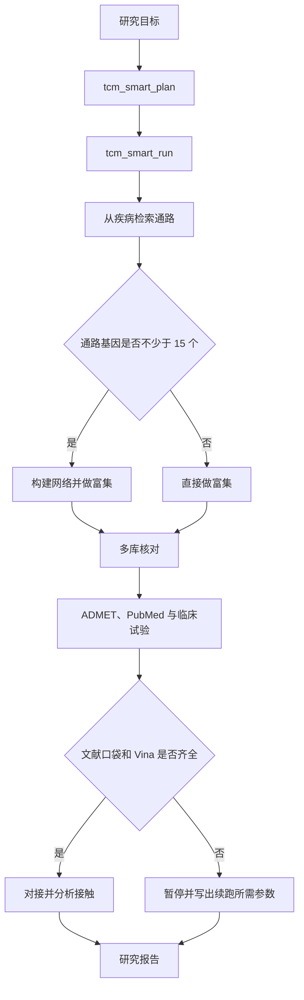

# OpenTCM Discovery

这个仓库做中药小分子的检索和筛选。做网络药理学和天然产物前期研究的人可以用。63 个工具放在同一个 MCP 服务里。它们负责查疾病通路，核对成分和靶点，做蛋白互作网络，估算理化性质。粘贴的表可以在本地整理标识、基因符号、疾病名、剂量和 SMILES。文献写明了口袋，再做分子对接。

在 Cursor 里接上 MCP 之后，直接用中文说明疾病和成分就可以。命令行跑的是同一套工具。对接结果只是提出的结合模型，口袋残基要来自文献。文献共现和临床试验匹配，用来找下一步要读的论文和要做的实验。

[](LICENSE)
[](requirements.txt)
[](docs/TOOLS.md)

一次分析一般从疾病或成分开始。先查公开数据库。再按通路基因的数量，决定画不画蛋白互作网络。然后看这个靶点或成分有没有被多个库同时收录。文献写明了结合口袋，才跑 AutoDock Vina。每条在线结果都带 `source` 和 `queried_at`。完整的科学边界见 [docs/SCIENTIFIC_SCOPE.md](docs/SCIENTIFIC_SCOPE.md)。后面要补的数据库和测试见 [docs/ROADMAP.md](docs/ROADMAP.md)。

## 目录

- [适合谁](#适合谁)
- [现在能做的事](#现在能做的事)
- [快速开始](#快速开始)
- [接入方式](#接入方式)
- [两条计算路径](#两条计算路径)
- [七个模块](#七个模块)
- [证据怎么写](#证据怎么写)
- [数据和上游库](#数据和上游库)
- [仓库结构](#仓库结构)
- [自检](#自检)
- [引用与许可](#引用与许可)

## 适合谁

做中药或天然产物的计算筛选，可以先在这里查三件事：一个疾病有哪些通路，一味药里收录了哪些成分，一个成分在哪些数据库里能对上。文献里如果写了口袋，再看对接姿势。

用法有两种。

第一种走 MCP。在 Cursor 里用中文说明目标，调用这 63 个工具。

第二种走本地打分。读取你自己准备的机制表、临床药表和分子库。

两条路互不调用。在线检索和本地加权分不要写成同一条证据。

## 现在能做的事

| 你想回答的问题 | 从这里开始 |
|---|---|
| 这个疾病对应哪些通路和基因？ | `tcm_kegg_disease_pathways`，或直接运行 `tcm_smart_run` |
| 这个成分或基因是否被多个数据库同时收录？ | `tcm_cross_database_screen` |
| 网络里哪些基因更靠中心，两条富集是否一致？ | `tcm_network_analysis`，然后 `tcm_multi_enrichment` |
| 黄连和黄芩的成分集合重叠多少？ | `tcm_formula_analysis` |
| 文献已经给出口袋，想看一个对接姿势 | `dock_vina_docking`，然后 `dock_analyze_contacts` |
| 几个成分里先做哪一个实验？ | `tcm_multi_path_run`。排名是启发式排序，不是验证过的打分函数 |
| 手里已有机制表和分子库，想做可重复的加权评分 | `workflow_engine/run_server.py` |
| 表、基因名、疾病名、剂量或 SMILES 还乱着？ | `tcm_clean_table`、`tcm_normalize_ids`、`tcm_normalize_genes`、`tcm_normalize_disease`、`tcm_convert_dose`、`tcm_normalize_structure` |

全部工具的分工见 [docs/TOOLS.md](docs/TOOLS.md)。

## 快速开始

需要 Python 3.10 或更高版本。

```bash
python -m pip install -r requirements.txt
```

在 Windows 上先执行 `$env:PYTHONUTF8="1"`，免得中文输出乱码。

下面的命令会启动服务器，打印已注册工具的数量，并探测一次数据库状态：

```bash
python examples/basic_usage.py
```

正常时会看到 `tools registered: 63`。这一步要访问公网。没有网络时，服务器仍能启动。检索工具会返回上游的报错，不会在本地编一条结果。

分子对接还要准备 AutoDock Vina 1.2.5 和 Meeko。可执行文件不放进 Git。放法见 [bin/README.md](bin/README.md)。没装 Vina 时，检索、网络、文献和临床试验工具照常可用。

## 接入方式

推荐用 stdio。把下面的配置贴进 MCP 客户端，路径改成你本机的克隆目录。同一份模板在 [mcp_server/deployment_config.json](mcp_server/deployment_config.json)。

```json
{
  "mcpServers": {
    "open-tcm-discovery": {
      "command": "python",
      "args": ["D:/path/to/open-tcm-discovery/mcp_server/unified_mcp.py", "--stdio"],
      "env": { "PYTHONUTF8": "1" }
    }
  }
}
```

如果要常驻 HTTP，进程只绑本机。默认端口是 **8002**：

```bash
python mcp_server/unified_mcp.py --port 8002
```

客户端地址是 `http://127.0.0.1:8002/mcp`。完整服务是 `unified_mcp.py`。单独跑 `open_tcm_discovery_mcp.py`，只有检索工具，端口默认是 8000。

带参数的工具把参数放在 `params` 里：

```python
await session.call_tool("tcm_smart_run", {
    "params": {
        "goal": "研究溃疡性结肠炎的候选成分 berberine，给出 ADMET、文献共现和临床试验情况",
        "max_runtime": 400
    }
})
```

环境变量、端口冲突和常见报错见 [docs/DEPLOYMENT.md](docs/DEPLOYMENT.md)。

## 两条计算路径



`tcm_smart_plan` 只生成计划。`tcm_smart_run` 执行图里的在线步骤。深度设为 `full` 时，四步药材脚本记成一条延后命令，不会在同一次请求里抓那 30 到 60 分钟的数据。

另一条路径是本地有向无环图。它读你自己的 Excel 和 CTD 文件，在 8765 端口打开看板，不调用上面的 MCP 工具。步骤、阈值和断点续跑见 [docs/WORKFLOWS.md](docs/WORKFLOWS.md)。模块怎么分层见 [docs/ARCHITECTURE.md](docs/ARCHITECTURE.md)。

## 七个模块

| 模块 | 它负责什么 | 说明 |
|---|---|---|
| M1 | 从疾病到通路、药材、口服生物利用度达标的成分，再做错误发现率校正 | [m1_disease_screening.md](modules/m1_disease_screening.md) |
| M2 | 多个数据库的共识、靶点开发等级和标识互转 | [m2_target_evidence.md](modules/m2_target_evidence.md) |
| M3 | 网络中心节点，以及两个富集引擎是否一致 | [m3_network_enrichment.md](modules/m3_network_enrichment.md) |
| M4 | 分子库构建、质量检查和五层去重 | [m4_molecular_library.md](modules/m4_molecular_library.md) |
| M5 | Vina 对接、接触分析和几何蛋白质相互作用 | [m5_docking_modeling.md](modules/m5_docking_modeling.md) |
| M6 | 论文图和证据标注 | [m6_figures_documentation.md](modules/m6_figures_documentation.md) |
| M7 | 记录运行中发现的失效接口和复现问题 | [m7_self_iteration.md](modules/m7_self_iteration.md) |

口服生物利用度不低于 30，类药性不低于 0.18，才按 TCMSP 的历史口径放进「活性成分」。RDKit 算的 Lipinski 和 QED 是另一套理化描述符。写报告时分开写，不要并成同一个结论。2026 年 9 月探测时，TCMSP 网站打不开。这道门只认你手里已有的 TCMSP 字段。其他库的类药性数字不能拿来顶替。

## 证据怎么写

实验记录、晶体或核磁模板、计算预测，分三层写。对接输出写成 proposed docking model。只在计算里出现的残基标星号，接触画虚线。

口袋残基必须来自文献。没有口袋，执行引擎就停，并列出缺什么。引擎不猜盒子，也不做全蛋白盲对接。2025 年有人核查过网络药理学论文。很多对接没写盒子中心和大小，其中不少其实是盲对接，别人很难复现（Frontiers in Pharmacology, 2025, 1566772）。

文献记载的已知相互作用，和靠相似搜索或对接打分预测出来的靶点，要分开写。HERB 用文献做 Fisher 精确检验来关联靶点。BATMAN-TCM 2.0 里既有人工核对过的相互作用，也有大规模预测。这两类数字不能加在一起叫「共识」（Frontiers in Pharmacology, 2024, 1303693；Nucleic Acids Research, 2024, gkad926）。现在的多库共识，只表示这些库都收录了该实体。它不表示实验已经证实了结合。已知靶点和预测靶点拆开计数。这件事写在 [下一阶段路线](docs/ROADMAP.md)。

## 数据和上游库

仓库里的 `data/herb_mol_index.json` 记了 698 味药材和 25,975 个成分的对应关系，用来算药对的成分集合。数据来自 SymMap 2.0 的药材与成分关联（Wu 等，Nucleic Acids Research, 2019, 47(D1): D1110–D1117）。这里没有写好的疾病答案。字段和重建方法见 [data/README.md](data/README.md)。

运行时会访问这些公开库：SymMap、PubChem、ChEMBL、KEGG、STRING、Open Targets、UniProt、NCBI、ClinicalTrials.gov、HERB、TCMBank、NPASS、TCMSP 旧站。每个库怎么进入、本仓库是否直接调用、哪些接口已经确认不能用，写在 [docs/DATA_SOURCES.md](docs/DATA_SOURCES.md)。请遵守各数据库自己的使用条款。仓库不带这些库的全量镜像。

## 仓库结构

```
SKILL.md                 给智能体读的使用约定
mcp_server/              63 个工具的服务器
tcm_core/                超几何检验、口袋残基和索引路径等可单测的函数
scripts/                 可单独运行的检索、分子库、对接和出图脚本
workflow_engine/         11 步本地打分流程和看板
modules/                 七个模块的说明
references/              接口、失效记录、作图和证据分级
data/                    SymMap 药材与成分索引
docs/                    给使用者和维护者的说明
tests/                   不访问网络的单元测试
examples/                最小客户端和调用样例
```

## 自检

```bash
python scripts/check_repo.py
python -m unittest discover -s tests -v
```

第一条命令不访问网络。它检查 Python 语法，核对 63 个工具名是否都写进了工具总表，并拦住已经废弃的端口、工具数和本机路径。第二条命令核对超几何尾概率、Benjamini–Hochberg 校正、成分名提取和口袋残基解析。扑克牌算例：52 张牌、13 张红心、抽 5 张，至少 3 张红心的概率约为 0.0928。

在线行为的历史记录在 [CHANGELOG.md](CHANGELOG.md) 和 `mcp_server/evaluation.xml`。上游接口会变。正式分析前先跑 `tcm_check_database_status`。

## 引用与许可

```bibtex
@software{open_tcm_discovery,
  title  = {OpenTCM Discovery},
  year   = {2026},
  url    = {https://github.com/S0mbraD/OpenTCM_Discovery},
  note   = {MCP service for TCM small-molecule discovery, 63 tools}
}
```

机器可读条目在 [CITATION.cff](CITATION.cff)。结果里用了 Vina 或 SymMap 的，请一并引用它们的论文。

代码使用 [MIT 许可证](LICENSE)。Vina 使用 Apache-2.0，说明见 [NOTICE](NOTICE)。

本仓库用于科研和教学，不能当作医疗建议。计算预测需要实验验证。

[文档](docs/README.md) · [贡献](CONTRIBUTING.md) · [安全](SECURITY.md) · [行为准则](CODE_OF_CONDUCT.md) · [变更](CHANGELOG.md)
